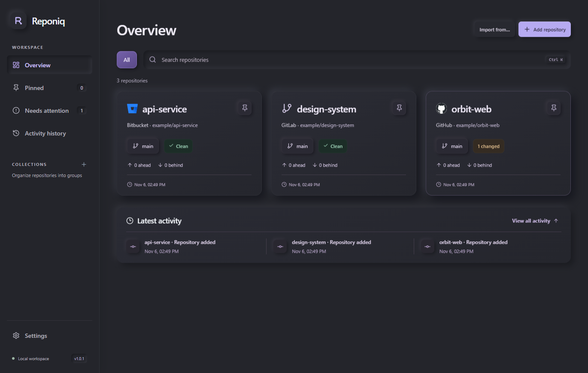

<p align="center"></p>
<h1 align="center">Reponiq</h1>
<p align="center">Your repositories. One focused workspace.</p>
<p align="center">
<a href="https://github.com/Louguerrier22/Reponiq/releases/tag/v1.0.1"></a>
<a href="https://github.com/Louguerrier22/Reponiq/actions/workflows/ci.yml"></a>
<a href="LICENSE"></a>
</p>
<p align="center"><a href="#download">Download</a> · <a href="docs/README.md">Documentation</a> · <a href="#supported-platforms">Supported platforms</a> · <a href="CHANGELOG.md">What's new</a> · <a href="CONTRIBUTING.md">Contribute</a></p>

A native desktop Git workspace for Windows and Linux. Organize projects, review changes, build small commits, resolve conflicts and manage GitHub pull requests without leaving your repository.



*Captured from Reponiq 1.0 with a disposable example repository. No generated UI artwork.*

## Download

| Platform | Installer | Runtime |
| --- | --- | --- |
| Windows 10/11 x64 | [Windows installer](https://github.com/Louguerrier22/Reponiq/releases/download/v1.0.1/Reponiq-1.0.1-windows-x64.exe) | Microsoft WebView2 |
| Ubuntu / Debian x64 | [Debian package](https://github.com/Louguerrier22/Reponiq/releases/download/v1.0.1/Reponiq-1.0.1-linux-x64.deb) | WebKitGTK 4.1 |
| Fedora / RHEL family x64 | [RPM package](https://github.com/Louguerrier22/Reponiq/releases/download/v1.0.1/Reponiq-1.0.1-linux-x64.rpm) | WebKitGTK 4.1 |
| Other Linux x64 | [AppImage](https://github.com/Louguerrier22/Reponiq/releases/download/v1.0.1/Reponiq-1.0.1-linux-x64.AppImage) | WebKitGTK 4.1 / FUSE support |

Install [Git](https://git-scm.com/downloads) first. See [installation and checksum verification](docs/INSTALLATION.md) for prerequisites. Installers are unsigned; there is no automatic updater. Repository access is required while distribution remains private. Availability and tested limits are recorded in [release verification](docs/RELEASE_CHECKLIST.md).

## A calmer Git workflow

**Start your project.** Create a local or GitHub repository, add an existing folder, or clone from a connected account. Pin projects, group them into collections and add tags with Enter.

**Review, then commit.** Select a file for its diff. Stage individual files and split work into separate commits. Inspect older commits and their files, or undo one with a new revert commit.

**Keep branches moving.** Switch from a real branch dropdown. Fetch, pull with fast-forward protection and push committed work. Resolve text conflicts inside the app, then continue or abort the operation.

**Work with pull requests.** Connect GitHub in your browser. Read patches, review, create a PR from a published branch and merge after checks and policy allow it.

First-run folder setup comes before a skippable walkthrough. Change the default folder and replay the tour from Settings. Import local repositories from GitHub Desktop history, VS Code recent folders, or any Git client's repository folder; review discovered entries before adding them.

## Supported platforms

 

       

| Capability | Support |
| --- | --- |
| Local repositories, commits, branches, fetch / pull / push | Any host supported by your installed Git and credentials |
| Provider identification | GitHub, GitLab, Bitbucket, Azure DevOps, Codeberg, Gitea, Forgejo, SourceHut; generic Git fallback |
| Browser sign-in, Actions monitoring, pull requests | GitHub.com |
| Conflict editor | Bounded UTF-8 text files; binary or oversized conflicts use external tools |
| Staging | Per file or all files; per-hunk staging is not included |
| Pull request creation | Current published branch into another branch in the same origin repository |
| Architectures | x64; macOS and ARM builds are not distributed |

Provider names describe compatibility, not endorsement. Some providers use neutral icons; see [asset terms](assets/platforms/README.md). Git authentication is separate from Reponiq's GitHub connection. Clone and remote creation support GitHub.com accounts. Safe revert preserves history; force-push and history rewriting are not exposed.

## Local by design

No Reponiq cloud account, telemetry or hosted backend. Organization and activity live in local SQLite; access and refresh credentials stay in the OS credential store. Network operations happen through your Git remotes and optional GitHub connection. [Privacy](docs/PRIVACY.md) · [Security](docs/SECURITY.md)

## Built with

     

Tauri uses the operating system's webview. Git is a separate installed prerequisite. Node.js and Rust are needed to build from source, not to run an installed package.

```sh
npm ci
npm run tauri dev
```

See [development](docs/DEVELOPMENT.md) for setup, tests and target-platform builds, and [architecture](docs/ARCHITECTURE.md) for ownership and storage contracts.

## Help and contribute

[User guide](docs/USER_GUIDE.md) · [Troubleshooting](docs/TROUBLESHOOTING.md) · [Report an issue](https://github.com/Louguerrier22/Reponiq/issues) · [Contributing](CONTRIBUTING.md) · [Roadmap](docs/ROADMAP.md)

MIT licensed. Reponiq artwork is original; provider marks and dependencies retain their own terms. [Third-party notices](THIRD_PARTY_NOTICES.txt) ship with the app.
