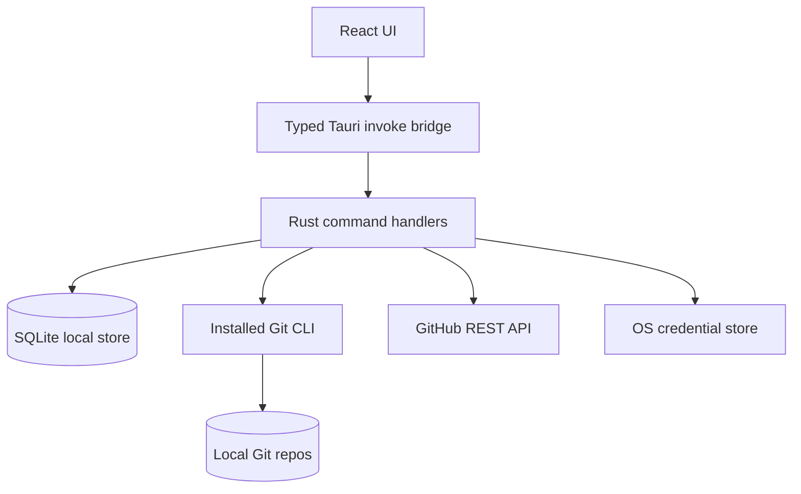

# Architecture

## Design intent

Reponiq is **local-first**. Tauri hosts the React UI, Rust performs I/O, SQLite stores local metadata, OS keyrings hold GitHub credentials, and installed `git` handles repository operations.

## System boundaries

**Frontend** (`src/react/App.tsx`, `src/lib/api.ts`): card shelf, collection/search filtering, focused workbench, changed-file selector, bounded read-only diff, pinned items, Git actions, events and settings. React renders views and MobX tracks state for the existing asynchronous workflows. No secrets should be persisted in frontend state beyond the active token-entry step.

Official shadcn/ui components live in `src/react/shadcn`. Reponiq's adapters retain its graphite and lavender styling and connect these components to application state. Radix handles keyboard and focus behavior for dialogs, tabs, and the sidebar drawer. The desktop updater stays mounted independently of the sidebar.

Appearance uses scoped theme variables shared by the workspace, dialogs, and the preview. Reponiq is the only bundled choice in the theme browser. Existing Nova and Lyra preferences still render. Downloaded themes from shadcn/ui, tweakcn, or a supported JSON link supply light and dark colors and radius. Applying the preview saves those tokens under the additive `appearance-registry-v1` preference. Sonner displays successful actions while actionable errors stay with their workflow. The Workflows tab reads the activity log for the current repository.

First-run setup advances through Appearance, Workspace, GitHub, Startup, and Review. A separate pending-account flag lets older builds resume at Startup. Startup fetch supports pinned, all, or selected repositories, with per-repository overrides. Checklist changes save with the startup scope in one transaction. SQLite keeps the checkpoint in `onboarding-step-v1` and appearance in `appearance-v1`. Both are additive to the 1.1.0 preferences contract. Completion writes the legacy `workspace-setup-complete` key in the same transaction as the final checkpoint. A legacy completion takes precedence when an older build completed setup during a rollback. The existing walkthrough key remains independent.

**Rust backend** (`src-tauri/src/lib.rs`): Tauri command handlers, local filesystem and Git calls, SQLite persistence, account validation, manual workflow sync and tray setup. `gitflow.rs` owns Git preflight, history, conflict and revert mechanics; `oauth.rs` owns device sign-in/refresh; `pulls.rs` owns bounded GitHub PR APIs; `catalog.rs` owns repository catalogs/create/clone; `conflict_file.rs` owns directory-bound text replacement; `create_directory.rs` owns atomic/private destination creation; `workspace.rs` owns fixed-key preferences and bounded local-client discovery/import. `git` is executed through argument arrays rather than a shell.

**SQLite**: tables `repos`, `accounts`, `activity` (schema initialized in `initialize`). Repo records point to existing local paths, with pinned status, collection, JSON tags, and last observed CI fields. Account records contain login and host, **not tokens**. Activity uses a unique source key to deduplicate observed entries. There is no migration framework yet.

**GitHub**: currently supports GitHub.com API (`api.github.com`); account validation via `/user` and manual recent Actions workflow run retrieval for registered repos. PR APIs support list/detail/file and commit patches, review, same-origin creation and guarded merge. Other hosts use system Git only. The account catalog lists accessible remote repositories and personal/organization creation owners.

## Data compatibility

The consolidated release retains existing repository/account/activity tables. New installations use the Reponiq data directory, `reponiq.sqlite`, and `reponiq` keyring service. When the legacy database exists, all reads and writes continue against it and its original keyring service, preserving existing records. No files or secrets are copied, renamed, or deleted. Fresh Reponiq installations are not discoverable by the previous app. Legacy detection errors fail startup rather than silently opening an empty database. Storage-selection regression tests cover both platform layouts and repeated selection; the isolated SQLite round-trip regression preserves unknown tables and supports previous-version queries after new writes. Installed OS-keyring upgrades remain a separate verification boundary.

## Operational caveats

- Local commands use a bounded blocking worker pool; shelf metadata reads do not execute Git. repo_summary checks one selected ID outside the database lock. The frontend schedules at most two status requests concurrently; native jobs queue asynchronously with 32 admitted/four executing bounds. All stored rows and unknown preferences remain preserved.
- Git activity log is limited and not an authoritative audit trail.
- GitHub sync is manually requested and rate-limit/error handling needs improvement.
- The tray offers Show and Quit. Optional launch fetch runs once after the shelf renders, with two concurrent jobs at most. Git operations serialize for worktrees that share a Git directory. Closing the window exits the app.
- Multiple accounts are stored; PR views explicitly select an account. Git uses separate system credentials.

## Workbench read contract

`git_action` retains its typed IPC shape; `diff` now accepts zero arguments (all changes) or one literal relative filename. Absolute paths, parent traversal, NUL and oversized arguments are rejected before Git starts. Both staged and working-tree diffs disable external diff/text conversion and colors, and remain bounded. Read-only diff requests do not write journal events. Change paths use Git’s NUL-delimited porcelain format, preserving spaces, Unicode and rename destinations. SQLite tables and stored codecs are unchanged.

Frontend selection/diff sequence numbers reject stale responses; changing repositories resets pending diff state and keeps commit drafts scoped to the repository ID during the session. Metadata and command results remain sourced from native IPC; browser layout tests inject synthetic fixtures only in their test harness.

Branch switching uses explicit local and remote refs. Git owns stashes and their recovery copies. The app checks for file collisions before stash and restore. PR creation rechecks the published base and head from the comparison just before requesting creation.

Launch fetch adds two keys to the existing preferences table. Previous binaries write their existing keys individually and preserve the new ones. Sign-in startup lives in the current user's OS startup settings. Disable that registration before rolling back if the older build should no longer open at sign-in.

Workflow preferences, draft scopes, pin order, last-known status, and observed publication tips live in additive SQLite tables. The repo insert trigger assigns a registration token even when an older binary adds a repository. Foreign keys remove the associated records when the registration is removed. Relinking preserves the registration and checks the known remote before updating the path. The previous binary can continue to read and update its existing tables.

Undo checks current remote refs and publication tips recorded by Reponiq. It updates the named local branch only if the expected tip still matches. Git records the previous tip in the reflog, and the index and working files remain in place. Repo status and launch fetch share a limit of three native worker slots so a fourth stays available for user actions.

## OAuth credential compatibility

The additive preferences(key,value) table stores walkthrough completion, first-run setup completion, default repository folder and automatic discovery preference. Old versions ignore it; old/new writer round-trip tests retain it and unknown settings. Existing repo/account/activity tables are unchanged. The raw github-account-{id} access-token entry remain compatible. A version2 github-oauth-{id} keyring sidecar holds refresh/client/expiry data and binds the selected account identity and legacy token mirror. Mismatched or unsupported metadata fails closed and requires reconnection. Reads prefer that sidecar and refresh before authenticated requests. Rotation saves the new sidecar before updating the legacy mirror so a failed mirror write retains the latest recovery credential. Such failures stop the action; retry reads the sidecar. Previous binaries can read the mirror but do not refresh expiring tokens, so rollback may require reconnection after expiry. PAT reconnection deliberately replaces OAuth credentials. Account changes are serialized and compensate failed store/database writes. Mock keyring error and codec tests do not establish every OS keyring upgrade/failure combination; that remains a release verification requirement.

No destructive migrations are introduced. Unknown SQLite data remains preserved. Cancellation cannot complete another device session. UI sequence numbers reject stale selections; Git confirmations carry branch/HEAD expectations and conflict writes compare original file content. PR merge uses an exact reviewed head SHA.

## Filesystem and subprocess authority

Conflict reads open without following a leaf symlink, reject nonregular files and bound text to1MiB. Replacement uses exclusive temporary creation and rename relative to the same retained parent directory. Unix reads are nonblocking before the regular-file check.

Windows creates each destination atomically with a protected private DACL for the current user, SYSTEM and administrators. Linux creates mode-0700 children in a parent owned by the current user. Creation and cloning retain directory handles and Git starts from the newly created object. Windows handles deny share-delete. Linux uses the retained directory descriptor before exec. Registration verifies that the folder still reachable at the saved path is the one that was created. Linux registration also requires a trusted path as described below. If registration fails, the created files are preserved.

Git is resolved from absolute PATH entries to an absolute executable before changing the child's working directory. A git executable in cloned contents is not selected. Git hooks, filters and configured helpers remain the existing system Git trust boundary; only trusted repositories and parent folders should be used.

Linux checks the owner and permissions of directory components and opens them without following aliases before running Git. Git starts from the verified working-directory handle. Linked worktrees also check their Git metadata locations. The first access to an existing registration in a trusted location records the folder's device and inode. If the folder object changes, use **Locate folder** to confirm it again. The identity table is additive, so earlier versions can still read the workspace. Earlier versions do not enforce the new identity check. Relinking with an earlier version requires reviewing the new location when returning to this version.

The app continues to store GitHub credentials in the OS keyring using the existing format. Once rotation saves the new credential, a later read can repair an interrupted update to the older token entry. If GitHub has invalidated the previous refresh token before the new one reaches the keyring, reconnect that account.

Credential operations share an OS file lock for the login that owns the keyring, including when two Reponiq instances open different workspace paths. The lock is released when the process exits and contains no credential data. Stop earlier versions before upgrading or rolling back because they do not take this lock. The SQLite schema and credential format are unchanged.

Git stdout and stderr use pipes with a 4 MiB limit per stream. The app retains up to 64 KiB of stderr for diagnostics and writes no captured output to temporary files. File-selection input is staged completely before starting Git, with a 4 MiB cap per operation. If an administrator configures [managed scratch](INSTALLATION.md#managed-git-scratch), Reponiq checks the volume and routes Git's temporary directory and staged inputs into a fresh directory on that volume. Its capacity limits the space occupied by simultaneous operations and previously interrupted jobs. Repository writes and custom helper paths outside the managed volume follow normal Git behavior. Windows assigns Git to a kill-on-close job before resuming its initial thread. On Linux, a separate supervisor owns the Git process tree. It terminates and reaps remaining helpers when Git exits or when Reponiq closes or loses the control pipe, including after a forced termination of the app. The supervisor requires Linux procfs and prevents Git and its helpers from gaining privileges. System Git uses the distribution's libraries when Reponiq runs as an AppImage. Use trusted Git hooks and helpers.

Discovery and import preflight use a read-only process with a separate admission slot and bounded input, results, and wall-clock response. If a filesystem call stalls, the caller can return without holding a regular workspace worker or a database transaction. The probe slot stays occupied until the OS reaps the old process. Import commits each successful registration independently, so interrupted batches can retry the folders that remain. The workspace schema and credential format are unchanged.

Private GitHub clones run in a supervised process in the new repository directory. The desktop sends the already authorized request over a pipe. Git downloads through HTTPS with TLS verification, using clean Git configuration and an empty template. Set standard proxy and CA environment variables such as `HTTPS_PROXY` and `GIT_SSL_CAINFO` when the private transfer needs them. A separate Git command checks out the default branch with the usual Git configuration and without the app credential. GitHub catalog clones clear saved authorization headers and cookie files for the selected repository URL. Disconnect governs future operations. It cannot revoke the provider's token or cancel an already-authorized transfer.

Supervised commands use Git's regular status scan so they do not start a persistent FSMonitor daemon. The temporary command override leaves repository and global Git settings intact.
