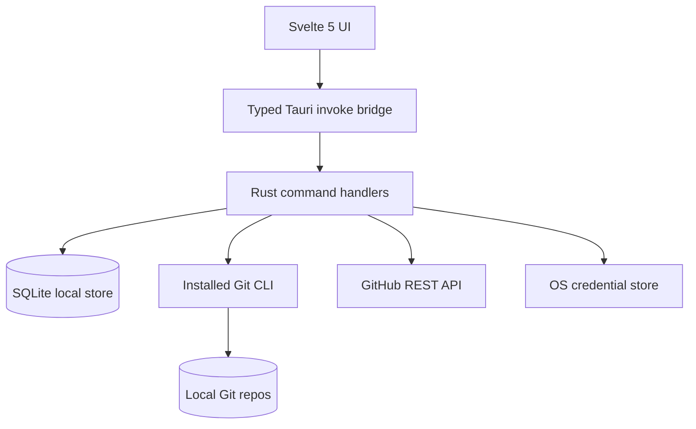

# Architecture

## Design intent

Reponiq is **local-first**, native, and intentionally small. Tauri hosts the Svelte UI, Rust performs I/O, SQLite stores local metadata, OS keyrings hold GitHub credentials, and installed `git` handles repository operations.

## System boundaries

**Frontend** (`src/App.svelte`, `src/lib/api.ts`): card shelf, collection/search filtering, focused workbench, changed-file selector, bounded read-only diff, pinned items, Git actions, events and settings. No secrets should be persisted in frontend state beyond the active token-entry step.

**Rust backend** (`src-tauri/src/lib.rs`): Tauri command handlers, local filesystem and Git calls, SQLite persistence, account validation, manual workflow sync and tray setup. `gitflow.rs` owns Git preflight, history, conflict and revert mechanics; `oauth.rs` owns device sign-in/refresh; `pulls.rs` owns bounded GitHub PR APIs; `catalog.rs` owns repository catalogs/create/clone; `conflict_file.rs` owns directory-bound text replacement; `create_directory.rs` owns atomic/private destination creation; `workspace.rs` owns fixed-key preferences and bounded local-client discovery/import. `git` is executed through argument arrays rather than a shell.

**SQLite**: tables `repos`, `accounts`, `activity` (schema initialized in `initialize`). Repo records point to existing local paths, with pinned status, collection, JSON tags, and last observed CI fields. Account records contain login and host, **not tokens**. Activity uses a unique source key to deduplicate observed entries. There is no migration framework yet.

**GitHub**: currently supports GitHub.com API (`api.github.com`); account validation via `/user` and manual recent Actions workflow run retrieval for registered repos. PR APIs support list/detail/file and commit patches, review, same-origin creation and guarded merge. Other hosts use system Git only. The account catalog lists accessible remote repositories and personal/organization creation owners.

## Data compatibility

The consolidated release retains existing repository/account/activity tables. New installations use the Reponiq data directory, `reponiq.sqlite`, and `reponiq` keyring service. When the legacy database exists, all reads and writes continue against it and its original keyring service, preserving existing records. No files or secrets are copied, renamed, or deleted. Fresh Reponiq installations are not discoverable by the previous app. Legacy detection errors fail startup rather than silently opening an empty database. Storage-selection regression tests cover both platform layouts and repeated selection; the isolated SQLite round-trip regression preserves unknown tables and supports previous-version queries after new writes. Installed OS-keyring upgrades remain a separate verification boundary.

## Operational caveats

- Local commands use a bounded blocking worker pool; shelf metadata reads do not execute Git. repo_summary checks one selected ID outside the database lock. The frontend schedules at most two status requests concurrently; native jobs queue asynchronously with 32 admitted/four executing bounds. All stored rows and unknown preferences remain preserved.
- Git activity log is limited and not an authoritative audit trail.
- GitHub sync is manually requested and rate-limit/error handling needs improvement.
- The tray offers Show and Quit; no background polling or close-to-tray mode yet.
- Multiple accounts are stored; PR views explicitly select an account. Git uses separate system credentials.

## Workbench read contract

`git_action` retains its typed IPC shape; `diff` now accepts zero arguments (all changes) or one literal relative filename. Absolute paths, parent traversal, NUL and oversized arguments are rejected before Git starts. Both staged and working-tree diffs disable external diff/text conversion and colors, and remain bounded. Read-only diff requests do not write journal events. Change paths use Git’s NUL-delimited porcelain format, preserving spaces, Unicode and rename destinations. SQLite tables and stored codecs are unchanged.

Frontend selection/diff sequence numbers reject stale responses; changing repositories resets pending diff state and keeps commit drafts scoped to the repository ID during the session. Metadata and command results remain sourced from native IPC; browser layout tests inject synthetic fixtures only in their test harness.

## OAuth credential compatibility

The additive preferences(key,value) table stores walkthrough completion, first-run setup completion, default repository folder and automatic discovery preference. Old versions ignore it; old/new writer round-trip tests retain it and unknown settings. Existing repo/account/activity tables are unchanged. The raw github-account-{id} access-token entry remain compatible. A version2 github-oauth-{id} keyring sidecar holds refresh/client/expiry data and binds the selected account identity and legacy token mirror. Mismatched or unsupported metadata fails closed and requires reconnection. Reads prefer that sidecar and refresh before authenticated requests. Rotation saves the new sidecar before updating the legacy mirror so a failed mirror write retains the latest recovery credential. Such failures stop the action; retry reads the sidecar. Previous binaries can read the mirror but do not refresh expiring tokens, so rollback may require reconnection after expiry. PAT reconnection deliberately replaces OAuth credentials. Account changes are serialized and compensate failed store/database writes. Mock keyring error and codec tests do not establish every OS keyring upgrade/failure combination; that remains a release verification requirement.

No destructive migrations are introduced. Unknown SQLite data remains preserved. Cancellation cannot complete another device session. UI sequence numbers reject stale selections; Git confirmations carry branch/HEAD expectations and conflict writes compare original file content. PR merge uses an exact reviewed head SHA.

## Filesystem and subprocess authority

Conflict reads open without following a leaf symlink, reject nonregular files and bound text to1MiB. Replacement uses exclusive temporary creation and rename relative to the same retained parent directory. Unix reads are nonblocking before the regular-file check.

Windows creates each destination atomically with a protected private DACL for the current user, SYSTEM and administrators. Linux requires a current-user-owned parent with no group/other write access and creates mode0700 children. Create/Clone open canonical parent components without following substituted links and retain directory handles. Git receives a directory-bound OS working directory before execution; clone targets that directory, not a reopened destination pathname. Windows handles deny share-delete; Linux uses the retained directory descriptor before exec. Registration reads through the same directory and rejects an observed moved destination. Partial local results are preserved.

Git is resolved from absolute PATH entries to an absolute executable before changing the child's working directory. A git executable in cloned contents is not selected. Git hooks, filters and configured helpers remain the existing system Git trust boundary; only trusted repositories and parent folders should be used.
