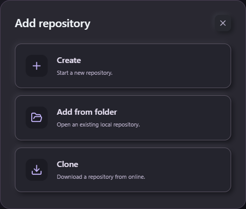
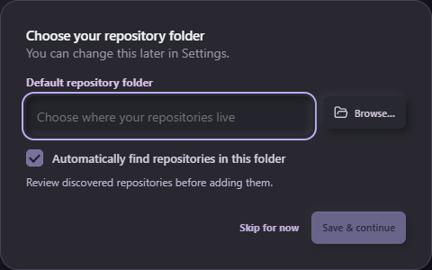

# User guide

[Documentation](README.md) · [Install](INSTALLATION.md) · [Troubleshooting](TROUBLESHOOTING.md)

This guide describes Reponiq 1.0.0. On first launch, choose a default repository folder or skip setup. A short walkthrough then introduces repositories, commits and remote work. Skip or finish it at any time; reopen it from the bottom of Settings.

## Repositories and organization

Choose **Add repository** and select one of three paths.

**Add from folder** opens an existing local repository. Browse uses the operating system's folder dialog; cancel preserves the field. Registration does not move or upload code.

**Clone** lists GitHub repositories under your connected accounts. Expand an account, choose a repository, then choose a parent folder and local folder name. Lists are paged at 25 items; search filters the current page. Clone uses system Git credentials, which may differ from the selected API account. Existing destination folders are refused. Failed clones preserve partial files; inspect that folder before retrying.

**Create** starts an empty local repository on main. Choose Local only, or a connected GitHub account and an available personal/organization owner. GitHub creation defaults to Private and creates an empty remote; it does not upload source or push a commit. Organization policy and token permissions remain authoritative. Choose a new folder name inside an existing parent folder. If remote setup fails after local creation, the local repository stays registered and the app reports the partial result. Check GitHub before retrying remote creation.

Git operations use installed Git and its existing authentication for any configured host. Online account catalogs and remote creation currently support GitHub.com only.

Enter a tag and press Enter to make a removable chip. A collection uses the same interaction, with one collection per repository. Commas are ordinary text. Search, collections and pins organize the shelf. Opening a repository shows one focused workbench; All repositories returns to the shelf.

Provider badges identify recognized hosts. Self-hosted detection is a display hint, never a credential-routing rule. GitLab and some other hosts use a neutral icon with the provider name because bundled branded artwork is not licensed for this use.

## Setup and importing existing repositories

Choose the default repository folder with the native **Browse...** dialog. Create and Clone start with this location. Settings > Repository folder lets you change it and enable automatic discovery. Detection checks local folders at startup and during the idle refresh; it does not move, clone, upload or register repositories. Choose **Review & import**, check the repositories you want, then import them. An unavailable saved folder stays saved and offers a repair choice.

**Import from...** offers GitHub Desktop, Visual Studio Code, your default folder, or a folder used by any Git client. GitHub Desktop import reads repository paths from its local history logs; this is a best-effort discovery aid, not a complete export of its library. Old or missing log entries may be absent. VS Code import reads recent local folder paths. For SourceTree, GitKraken, another editor or missing entries, choose **Folder - any Git client** and scan the folder containing those repositories. Account credentials and client settings are not imported.

Review happens before Reponiq runs Git for these candidates. Register only repositories you trust. Discovery excludes registered paths, skips generated/hidden directories, and scans at most three levels, 4,000 entries, 200 candidates or 12 seconds. Choose a smaller folder if a limit is reached. Worktree `.git` files are recognized; bare repositories are not included. Import preserves original locations and reports partial results so failed entries can be reviewed separately.

On Linux, Create and Clone require a parent folder owned by your account that other users cannot modify. Existing repository registration has no such creation restriction.

## Changes, branches and commits

Use the branch dropdown to switch branches or create one. Select a file to inspect its diff; its checkbox stages or unstages it. Commit requires staged changes and a message. To split changes into several commits, stage a subset of files, commit it, then stage the next subset. Per-hunk staging is not available. Untracked files show a Git diff once staged; binary changes may have no text preview.

History lets you select a commit, inspect its files and open each file's diff. Load more retrieves another page. Revert creates a new undo commit and preserves history. Reverting a merge uses its first parent; the confirmation explains this. Commit drafts stay in memory for this session.

## Fetch, pull and push

Fetch updates remote references without changing working files. Pull fetches the tracking remote and only fast-forwards a clean working tree. If histories diverge, choose the explicit Merge upstream action. Push requires all working changes to be committed, a normal attached branch and no unresolved operation. It checks remote changes before pushing and never force-pushes. A deleted upstream is reported rather than silently recreated. GitHub sign-in does not replace system Git credentials.

When a merge, rebase, cherry-pick or revert pauses, resolve each conflicted file, then Continue. The conflict editor offers current/incoming content and an editable result. Save and stage records the resolution. It rejects stale external file edits. Delete resolution is offered only for deletion conflicts and requires confirmation. Abort warns that in-progress resolutions may be lost. Binary, oversized and unsafe-path conflicts require external tooling. Register only trusted repositories: Git hooks, filters and helpers can execute under your user account.

## GitHub connection and pull requests

Settings offers browser sign-in. Start, open GitHub, enter/confirm the displayed device code there, and authorize the requested access. Cancel stops this pending connection. Public repository access uses public_repo and read:org; private access requests the broader repo scope plus read:org. These scopes permit repository/PR writes and reading organization membership. Use a fine-grained PAT restricted to selected repositories instead when appropriate: Actions Read for monitoring, Pull requests Read/Write for reviews/creation, and Contents Read/Write for merge as required by GitHub. Organization policy may require separate approval.

Credentials remain in the OS credential store. Browser access tokens refresh natively; no client secret is bundled. Disconnect deletes local credentials; revoke access in GitHub settings to revoke the remote authorization too. GitHub.com is the only account/API host supported.

For a repository whose origin is GitHub.com, open Pull requests and choose an account. Select a PR, its files or a commit to inspect patches. Submit a comment, approval or requested changes. Creation uses the clean, published current branch and another base branch in that same origin repository. A fork-target creation picker is not included. Merge confirms the reviewed head and rechecks checks, reviews and provider policy. New commits, pending checks, conflicts or incomplete metadata block it. GitHub remains the final authority for branch protection. After merge, Fetch updates local references; Pull updates your local branch when possible.

Lists load 25 PRs and 100 files per page. Commit selection covers the first 100 PR commits. Local history loads 50 commits per page up to 10,000; commit files are bounded at 1,000. Diffs display at most 1,500 lines / 200,000 characters. Large or truncated patches may need external tooling. Errors after an uncertain network result require refreshing before retrying an action.

## Activity, storage and keyboard

Sync GitHub manually retrieves recent Actions runs. It is not a complete GitHub audit trail. No background GitHub polling is configured. Ctrl+K focuses shelf search. Escape dismisses idle dialogs; mutation dialogs stay open until the operation finishes. Focus returns to the trigger.

Windows stores metadata at %APPDATA%\Reponiq\reponiq.sqlite. Linux uses ${XDG_DATA_HOME:-~/.local/share}/reponiq/reponiq.sqlite. Existing ForgeDesk installations continue using ForgeDesk/forgedesk.sqlite (Windows) or forgedesk/forgedesk.sqlite (Linux), with the original credential namespace. If both databases exist, the legacy database takes priority; they are not merged automatically. Back up the database separately from the OS credential store.

Removing a repository removes only its local workspace record. Saved activity may still contain names or paths. The tray offers Show and Quit; there is no guaranteed close-to-tray background service. Git operations have deadlines and bounded output; inspect repository state before retrying interrupted mutations.
