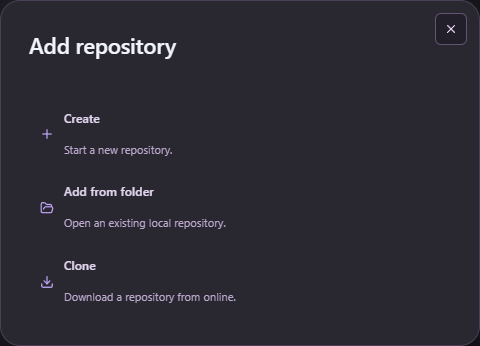
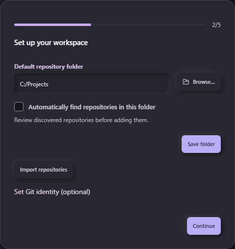

# User guide

[Documentation](README.md) · [Install](INSTALLATION.md) · [Troubleshooting](TROUBLESHOOTING.md)

On first launch, choose a default repository folder or skip it. The Startup step lets you opt into refreshing remote branches or starting Reponiq at sign-in. A short walkthrough then introduces repositories, commits and remote work. Skip or finish it at any time and reopen it from Settings.

## Repositories and organization

Choose **Add repository** and select one of three paths.

**Add from folder** opens an existing local repository. Browse uses the operating system's folder dialog; cancel preserves the field. Registration does not move or upload code.

**Clone** offers **GitHub accounts** and **Repository URL**. Expand an account and choose a repository, or paste an HTTPS or SSH clone URL from any Git host. URL cloning works without connecting an account and suggests the local folder name. Choose a parent folder and local folder name, then clone. Account lists are paged at 25 items; search filters the current page. Public repositories selected from the account list clone without authentication; private repositories use that selected GitHub account. URL cloning uses system Git credentials or your SSH key. Existing destination folders are refused. Clones can run for up to 15 minutes. Failed clones preserve partial files; inspect that folder before retrying with a new folder name.

**Create** starts an empty local repository on main. Choose Local only, or a connected GitHub account and an available personal/organization owner. GitHub creation defaults to Private and creates an empty remote; it does not upload source or push a commit. Organization policy and token permissions remain authoritative. Choose a new folder name inside an existing parent folder. If remote setup fails after local creation, the local repository stays registered and the app reports the partial result. Check GitHub before retrying remote creation.

Git operations use installed Git and its existing authentication for any configured host. Online account catalogs and remote creation currently support GitHub.com only.

Enter a tag and press Enter to make a removable chip. A collection uses the same interaction, with one collection per repository. Commas are ordinary text. Search, collections and pins organize the shelf. Opening a repository shows one focused workbench; All repositories returns to the shelf.

Provider badges identify recognized hosts. Self-hosted detection is a display hint, never a credential-routing rule. GitLab and some other hosts use a neutral icon with the provider name because bundled branded artwork is not licensed for this use.

## Setup and importing existing repositories

Choose the default repository folder with the native **Browse...** dialog. Create and Clone start with this location. Settings > Repository folder lets you change it and enable automatic discovery. Detection checks local folders at startup and during the idle refresh; it does not move, clone, upload or register repositories. Choose **Review & import**, check the repositories you want, then import them. An unavailable saved folder stays saved and offers a repair choice.

**Import from...** offers GitHub Desktop, Visual Studio Code, your default folder, or a folder used by any Git client. GitHub Desktop import reads repository paths from its local history logs; this is a best-effort discovery aid, not a complete export of its library. Old or missing log entries may be absent, so GitHub Desktop import also scans your saved repository folder when one is configured. Each candidate identifies its source; this fallback can include repositories that were not recorded by GitHub Desktop. VS Code import reads recent local folder paths. For SourceTree, GitKraken, another editor or missing entries, choose **Folder - any Git client** and scan the folder containing those repositories. Account credentials and client settings are not imported.

Review happens before Reponiq runs Git for these candidates. Register only repositories you trust. Discovery excludes registered paths, skips generated/hidden directories, and scans at most three levels, 4,000 entries, 200 candidates or 12 seconds. Choose a smaller folder if a limit is reached. Worktree `.git` files are recognized; bare repositories are not included. Import preserves original locations and reports partial results so failed entries can be reviewed separately. Each failed path includes a recovery reason; a batch time limit is distinguished from a repository/Git error. Successful import clears the old shelf search so new entries are visible. Already registered folders are omitted from discovery.

On Linux, Create and Clone require a parent folder owned by your account that other users cannot modify. Existing repository registration has no such creation restriction.

## Changes, branches and commits

Open the current branch button and search for a local branch or a branch fetched from a remote. If a branch is missing, choose **Fetch branches** and search again. Selecting a remote branch creates a local branch that tracks the named remote. Select **Create branch** to start a new branch from your current commit.

With edits on your current branch, choose **Switch with changes** or **Stash and switch**. Use **Stash changes** in the workbench to save edits and stay on the current branch. To recover staged, unstaged, or new files, open **Saved changes** on that branch and select **Restore** when the working folder is clean. Reponiq keeps the recovery copy in the Git stash.

In **Changes**, select a filename to inspect its diff. Use **Commit all** when no files are checked, **Include checked** to commit checked files, or **Exclude checked** to leave them out. The file count includes any hidden files that will be committed. **Reset to all files** clears the checkmarks. Each included file is committed from its current working copy. Use **Stage to preview diff** to inspect a new file before committing.

History lets you select a commit, inspect its files, and open each file's diff. **Undo last local commit** moves an eligible branch back one commit and keeps the edits staged. Reponiq checks current remote refs and known publication history before undoing a commit. If a remote check cannot be completed, use **Revert** for a shared commit. Revert creates a new commit and preserves history. Reverting a merge uses its first parent.

Reponiq saves commit messages by repository and branch, and unsent PR text by repository, branch, account, and base. **Settings → Workflow defaults → Save drafts on this device** controls whether drafts survive a restart. Turning it off clears saved drafts. Text already opened in the session can remain until the app closes.

The commit area shows the author Git will use. Change the repository author using **Repository actions → Repository settings**. The GitHub account selected for PRs is a separate setting. The default-branch reminder offers a new branch that carries your edits, or lets you explicitly commit on the default branch. Repository settings can override the reminder.

Use **Collapse review paths** to fold files or folders such as lockfiles or generated output. The group count and **Show all** make those files easy to find. Search and grouping affect the list only, so hidden files can still be included in a commit. Press Ctrl+F to search the changes list.

## Fetch, pull and push

**Fetch** checks the remote without changing working files. The main button shows **Pull changes**, **Push commits**, **Publish branch**, or **Merge upstream** when available. Commit or stash local edits before pulling or pushing. Pull only fast-forwards. Choose **Merge upstream** to combine divergent history. Reponiq checks remote changes before pushing and never force-pushes. GitHub sign-in does not replace system Git credentials.

When a merge, rebase, cherry-pick or revert pauses, resolve each conflicted file, then Continue. The conflict editor offers current/incoming content and an editable result. Save and stage records the resolution. It rejects stale external file edits. Delete resolution is offered only for deletion conflicts and requires confirmation. Abort warns that in-progress resolutions may be lost. Binary, oversized and unsafe-path conflicts require external tooling. Register only trusted repositories: Git hooks, filters and helpers can execute under your user account.

## GitHub connection and pull requests

Settings offers browser sign-in. Start, open GitHub, enter/confirm the displayed device code there, and authorize the requested access. Cancel stops this pending connection. Public repository access uses public_repo and read:org; private access requests the broader repo scope plus read:org. These scopes permit repository/PR writes and reading organization membership. Use a fine-grained PAT restricted to selected repositories instead when appropriate: Actions Read for monitoring, Pull requests Read/Write for reviews/creation, and Contents Read/Write for merge as required by GitHub. Organization policy may require separate approval.

Credentials remain in the OS credential store. Browser access tokens refresh natively; no client secret is bundled. Disconnect deletes local credentials; revoke access in GitHub settings to revoke the remote authorization too. GitHub.com is the only account/API host supported.

For a repository whose origin is GitHub.com, open **Pull requests** and choose an account. To create a PR, commit and publish your branch, choose **New pull request**, and select the base branch in the same repository. Use **Compare changes** to see the commits and changed files, then fill in a title and description. Choose Draft when the change is still in progress.

To review, open the PR and inspect its files or individual commits. Open the checks and review history before commenting, approving, or requesting changes. **Merge** shows the selected method and reviewed commit. Reponiq rechecks the latest commit, reviews and checks before sending the merge request, and GitHub applies repository rules. After a merge, switch to the base branch and **Pull** to update your local copy when Git can fast-forward it.

Lists load 25 PRs and 100 files per page. Commit selection covers the first 100 PR commits. Local history loads 50 commits per page up to 10,000; commit files are bounded at 1,000. Diffs display at most 1,500 lines / 200,000 characters. Large or truncated patches may need external tooling. Errors after an uncertain network result require refreshing before retrying an action.

## Activity, storage and keyboard

Under **Settings → Startup**, enable **Fetch on launch** to refresh pinned repositories once per launch, or choose all registered repositories. Each repository can follow that scope, opt in, or use manual fetch only. The global switch must be enabled for any launch fetch to run. Fetch begins after the shelf appears and uses your existing Git credentials. A failure appears on the affected repo with **Retry fetch**. **Start Reponiq at sign-in** opens the normal window on your next OS sign-in. Both features start off. If you move an AppImage, reopen it at the new location and enable sign-in startup there to update the registration.

Sync GitHub manually retrieves recent Actions runs. The saved shelf loads before Git status checks, and local status updates while the window is visible or regains focus. Ctrl+K opens the repo switcher from the shelf or workbench. Use the arrow keys and Enter to open a repo, or use **Move up/down** to arrange pins. Open the selected repo in your editor, terminal, or file manager from the switcher or **Repository actions**. Choose an app-wide editor in Workflow defaults, or override it per repo. Escape dismisses idle dialogs and returns focus.

For a moved or missing repo, use **Locate folder** to preview the replacement before relinking. Relinking preserves your pins, tags, settings, and saved drafts. A different remote can be added as a separate repository. For PRs, the last account with a successful GitHub request and an optional preferred base are shown before comparison. **Open check** takes you to the failure on GitHub when the provider supplies a valid link.

Windows stores metadata at %APPDATA%\Reponiq\reponiq.sqlite. Linux uses ${XDG_DATA_HOME:-~/.local/share}/reponiq/reponiq.sqlite. Existing ForgeDesk installations continue using ForgeDesk/forgedesk.sqlite (Windows) or forgedesk/forgedesk.sqlite (Linux), with the original credential namespace. If both databases exist, the legacy database takes priority; they are not merged automatically. Back up the database separately from the OS credential store.

Removing a repository removes only its local workspace record. Saved activity may still contain names or paths. The tray offers Show and Quit; there is no guaranteed close-to-tray background service. Git operations have deadlines and bounded output; inspect repository state before retrying interrupted mutations.

## Live logs

Open **Settings > Live logs**, below **A quick tour**, to view application activity and error details. The viewer includes command names and durations, Git stderr when a command finishes, GitHub HTTP status, frontend console messages and uncaught errors, and native panics with available stack information. Command arguments, successful API response bodies, and Git stdout/diffs are not automatically logged.

Search messages or sources and filter by severity. **Pause** freezes the viewer while collection continues; **Resume** catches up. **Copy logs** and **Download logs** use the visible, filtered entries. Download opens a native save dialog. **Clear logs** clears retained and saved diagnostic history.

The viewer retains the latest 2,000 entries. Logs also persist next to the workspace database in `logs/reponiq.log` and `logs/reponiq.previous.log`, with each file bounded to 2 MiB. History is restored after restart. The viewer displays the current file path and any logging storage error. Common credential fields, credential-bearing URL components, known account secrets, and recognizable token formats are redacted before storage. Review local paths and private details before sharing a log. Logs stay on your device until you copy or export them.
